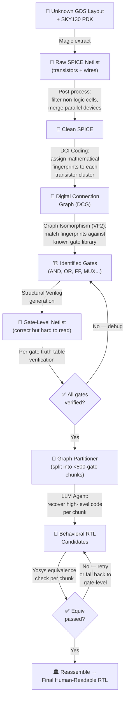

# Cracking Silicon: How I Reverse-Engineered a Hardware Puzzle and Built a Pipeline Out of It

**Author:** Sanjay Krishna  
**Background:** 4th-year Electronics & Communication Engineering student with a deep interest in chip design and building efficient hardware architectures.

---

## TL;DR

I solved this puzzle in two phases. First, I treated it as a CTF: I extracted the chip's netlist, analyzed the waveform timing to deduce the password length, pruned away irrelevant logic using synthesis tools, and used a mathematical constraint solver to find the exact 122-bit password. The flag was `(* TWO STARS *)`. Along the way, I uncovered several Easter eggs the creators had hidden in the design.

After capturing the flag, I thought: *why stop here?* I took the techniques I had used and extended them into a fully automated, end-to-end, open-source pipeline that can reverse-engineer *any* SKY130 GDS file back into readable logic — not just this one puzzle.

### The CTF Solving Flow


---

## Chapter 1: Opening the Box

When I first downloaded the challenge files, I got three things: `puzzle.gds` (the physical chip layout), `layout.png` (an image of the layout for reference), and `example_inputs.vcd` (a waveform recording).

I didn't jump straight into heavy tools. I opened the files one by one, starting with the simplest.

### The VCD File (First Easter Egg)

A **VCD file** is basically a recording of how electrical signals inside a chip change over time — think of it like an oscilloscope playback saved to a text file. I opened `example_inputs.vcd` in a plain text editor, and immediately noticed something odd in the header:

```
$date
  Sat Dec 31 23:59:60 2016
$end
$version
  Leave no stone unturned! But for this file, consider looking at it in a waveform viewer instead.
$end
```

Two things jumped out:

1. **The timestamp `23:59:60`** — that's not a typo! December 31, 2016 was the date of the last **Leap Second**, a rare event where UTC clocks briefly show 60 seconds. The creators had captured this VCD at that exact historical moment. *Easter Egg #1.*

2. **The hidden message in the version field** — *"Leave no stone unturned!"* — a direct hint from the creators that there are secrets hidden everywhere in this challenge.

### Decoding the Output (Second Easter Egg)

The puzzle has four pins: `clk` (clock), `rst_n` (reset), `enable`, and `I` (serial input). It outputs on `O[7:0]` (an 8-bit output bus) and `success` (a single-bit flag).

I wrote a quick Python script to decode what the `O[7:0]` output pins were doing in the VCD over time. The example input was just an alternating `1010...` pattern — clearly a dummy, not the real password. When I decoded the output, the circuit was literally mocking me:

**`TRY AGAIN`**

The designers had hardcoded a sarcastic response into the circuit for incorrect inputs! *Easter Egg #2.*

### The Critical Clue: Timing Analysis

But the most important discovery wasn't an Easter egg — it was the timing. I carefully counted the clock edges in the VCD. The `enable` signal was held high for 121 clock cycles, but the first character of `TRY AGAIN` appeared exactly on the **122nd clock edge** — the first cycle *after* enable went low.

This told me something crucial: the circuit's internal state machine evaluates its final answer on the 122nd cycle. The password wasn't 121 bits as the enable duration might suggest — it was **exactly 122 bits long**.

*(I later discovered that the physical layout of the chip confirmed this. If you zoom out and look at the placement of the standard cells — the tiny logic building blocks — on the die, they are physically arranged to spell out the giant number "122". The chip designers literally drew the answer on the silicon!)*

---

## Chapter 2: From Layout to Logic

Now I knew what I was looking for: a 122-bit password. But I couldn't just try random sequences — $2^{122}$ is an astronomically large number. I needed to understand *how* the circuit worked. To do that, I had to convert the raw physical layout back into logical code.

### Step 1: Guessing the Technology

The challenge was built on the **SKY130** process node (a free, open-source chip fabrication technology by SkyWater/Google). I was fairly confident about this given the warmup puzzles and the fact that the entire challenge was open-source.

### Step 2: Extracting the Netlist

My first thought was: *the closest thing to going from a physical layout to a gate-level description is what happens during LVS.* 

**LVS (Layout vs. Schematic)** is a standard chip design verification step where a tool reads the physical layout, extracts every transistor and wire, and compares it against the original schematic. Even though I didn't have the original schematic to compare against, I could still use the extraction step to pull out the raw electrical connections.

I used **Magic**, an open-source layout tool, to read the `puzzle.gds` file and extract a **SPICE netlist**. A SPICE netlist is a raw text file that lists every single transistor on the chip and exactly how they are all wired together. Think of it as a massive, detailed plumbing diagram of the chip — you can see every pipe and valve, but you don't yet know what the machine *does*.

### Step 3: Converting SPICE to Verilog

Here is where things got interesting. When I looked at the extracted SPICE file, I noticed that Magic had preserved the **standard cell** names. Standard cells are the basic, pre-designed building blocks of a chip — things like AND gates, OR gates, and Flip-Flops (tiny memory elements). Each one had a name like `sky130_fd_sc_hd__nand2_1` or `sky130_fd_sc_hd__dfrtp_2`.

Because I understood how SPICE subcircuit calls map to Verilog module instantiations, I wrote a Python script to parse every subcircuit call in the SPICE file and directly translate it into a **Verilog netlist**. Verilog is a hardware description language — it's basically code that describes how logic gates are connected. At this point, I finally had something I could simulate and analyze programmatically.

### The First Bottleneck: Broken Ports

This wasn't smooth sailing. When I first tried to load my generated Verilog into simulation tools, it crashed with syntax errors. The problem was that my script was declaring individual bus pins like `O[0], O[1], O[2]...` as separate ports, when Verilog requires them to be declared as a single bus: `output [7:0] O`. I had to go back and fix my port-grouping logic to correctly detect and merge bus signals. A small bug, but it cost me time.

---

## Chapter 3: Pruning the Dead Weight

I now had a working Verilog netlist with thousands of gates. But the challenge prompt had given me a massive shortcut:

> *"There is one section of the design that is used to generate the output but does not affect the [success] output. You can safely ignore it for the initial reverse-engineering steps."*

I looked at the `layout.png` image. Sure enough, there was a large block on the right side of the chip explicitly labeled **"output generator"**. This was the block responsible for printing strings like `TRY AGAIN` on the `O[7:0]` pins. It was interesting, but it had nothing to do with making the `success` pin go high.

I loaded my Verilog netlist into **Yosys**, an open-source digital synthesis and analysis tool. Yosys can do something incredibly powerful: a **cone-of-influence trace**. This algorithm starts at a specific output pin (in my case, `success`) and traces backward through all the wiring to identify every gate that *directly or indirectly* feeds into that pin. Everything else — every gate that only connects to the `O[7:0]` outputs — gets mathematically deleted.

This instantly stripped away the entire output generator, reducing my massive circuit down to a tiny, lightweight **sequence checker**. I went from thousands of gates to a manageable core that I could reason about.

### More Easter Eggs from the Output Generator

Before I deleted the output generator, I was curious about what other joke strings the designers had hidden. I ran a few obvious input patterns through my simulator:

| Input Pattern | Output String |
|---|---|
| Alternating `1010...` | **TRY AGAIN** |
| All zeros `0000...` | **EMPTY SKY** |
| All ones `1111...` | **BIG BANG** |

The designers had anticipated that people would try brute-forcing with obvious patterns and hardcoded sarcastic responses for each one. *Easter Eggs #3 and #4.*

---

## Chapter 4: Cracking the Lock

I now had a pruned, tiny sequence checker circuit and I knew the password was exactly 122 bits long. But trying every possible 122-bit combination would mean testing $2^{122}$ possibilities — that's roughly $5 \times 10^{36}$. If you could test a trillion combinations per second, it would still take longer than the age of the universe. Brute force was completely off the table.

### Enter the Z3 SMT Solver

Instead of guessing, I used a completely different approach: **formal constraint solving**. I used a tool called **Z3**, built by Microsoft Research. Z3 is an **SMT Solver** — which stands for **Satisfiability Modulo Theories**. 

The easiest way to understand an SMT solver is to think of a massive Sudoku puzzle. A human solving Sudoku doesn't randomly guess numbers until they work. They look at the rules (no repeating numbers in a row, column, or box) and use pure logic to deduce exactly what *must* go in each empty cell. An SMT solver does the same thing, but with millions of mathematical rules instead of nine.

I wrote a Python script that modeled my pruned sequence checker circuit as a set of mathematical equations. I unrolled the circuit for 122 clock cycles (one variable per input bit per cycle) and gave Z3 one simple rule: *"Find the 122-bit input where the `success` output equals 1."*

Z3 solved it in seconds.

### The Catch: Garbled Output

But there was a problem. The sequence Z3 found did make `success` go high — but when I fed it into the *full* circuit (with the output generator re-attached), the `O[7:0]` pins spat out unreadable binary garbage. The password was *technically* correct, but it wasn't the *intended* one.

I thought about this for a moment. The puzzle clearly outputs meaningful text for wrong answers (`TRY AGAIN`, `EMPTY SKY`, `BIG BANG`). So the *correct* answer should also produce readable text. 

I went back to my Z3 model and temporarily re-attached the output generator logic. Then I added one more constraint: *"Not only must `success` equal 1, but the output pins must produce values within the printable ASCII range (characters 32 to 126)."*

This was the breakthrough.

---

## Chapter 5: The Flag

With the ASCII constraint in place, Z3 found the **single, unique 122-bit sequence** that satisfies both conditions:

```
00000001010010001000000000000101010001000000001010000001000000010000000100001001000001000000001000100010010000010100000000
```

I ran one final simulation. I fed that exact bitstream into my circuit model, one bit per clock cycle. The `success` pin shot **HIGH**. And the output generator — the same block that had been mocking me with "TRY AGAIN" — shifted out the final, true flag:

```
(* TWO STARS *)
```

Puzzle solved.

---

## Chapter 6: The Hidden Puzzle and a Silicon Bug

After finding the password, a question remained: what does the 122-bit sequence actually *mean*? And why did the flag literally say `(* TWO STARS *)`? 

I decided to look closer at the 122-bit raw binary string. Here is what I found:
1. The sequence is exactly 122 bits long, but the core data is the first **121 bits** (with 1 padding bit).
2. Within those 121 bits, there are exactly **22 ones** and 99 zeros. 
3. $11 \times 11 = 121$.
4. $\frac{22 \text{ ones}}{11 \text{ rows}} = 2 \text{ ones per row/column}$.

It suddenly clicked. **The chip is a hardware constraint checker for a Star Battle logic puzzle.** 

Star Battle is a grid puzzle (like Sudoku) where you place stars such that every row, column, and irregular region has exactly $N$ stars, and no stars touch (even diagonally). The "Two Stars" variant means $N=2$. The flag `(* TWO STARS *)` was telling me the answer the whole time! 

If you solve this puzzle by hand, you map out the silicon's regions and find the human-intended solution—a perfect Star Battle grid with zero touching stars. 

But I didn't solve it by hand. I used Z3. And when I mapped out the 121 bits that Z3 mathematically generated, I found something incredible. Look at the human-intended solution versus the sequence my solver generated:

**The Human-Intended Solution (No Violations):**
```text
  Row  0: . . . . . . . ★ . ★ .
  Row  1: ★ . . . . ★ . . . . .
  Row  2: . . . . . . . ★ . ★ .
  Row  3: ★ . ★ . . . . . . . .
  Row  4: . . . . ★ . ★ . . . .
  Row  5: . . ★ . . . . . ★ . .
  Row  6: . . . . ★ . . . . . ★
  Row  7: . ★ . . . . ★ . . . .
  Row  8: . . . ★ . . . . . . ★
  Row  9: . . . . . ★ . . ★ . .
  Row 10: . ★ . ★ . . . . . . .
```

**Our Z3-Generated Solution (The Hardware Collision):**
```text
  Row  0: . . . . . . . ★ . ★ .
  Row  1: . ★ . . . ★ . . . . .
  Row  2: . . . . . . . ★ . ★ .
  Row  3: ★ . . . ★ . . . . . .   <-- Touch violation (Col 4)
  Row  4: . . ★ . ★ . . . . . .   <-- Touch violation (Col 4)
  Row  5: ★ . . . . . . . ★ . .
  Row  6: . . . . . ★ . . . . ★
  Row  7: . . ★ . . . . . ★ . .
  Row  8: . . . . . . ★ . . . ★   <-- Touch violation (Col 6)
  Row  9: . . . ★ . . ★ . . . .   <-- Touch violation (Col 3 & 6)
  Row 10: . ★ . ★ . . . . . . .   <-- Touch violation (Col 3)
```

Notice the difference? Our Z3-generated grid has **3 adjacency violations**. The stars are touching vertically! In Star Battle, stars are never allowed to touch. If a human submitted this grid, it would be marked wrong. Yet, when I fed *this* mathematically generated grid into the cycle-accurate Verilog simulation, it perfectly unlocked the chip and outputted the flag.

**We found a bug in the puzzle's hardware design.** 
The ASIC designers successfully implemented the row, column, and region checks in silicon, but their anti-adjacency logic is flawed! By using an SMT solver instead of solving the puzzle manually, we bypassed the human path entirely. Z3 mathematically generated a collision that exposed a physical vulnerability in the chip's constraint checker.

---

## Chapter 7: Going Beyond — Building the Pipeline

After the adrenaline of capturing the flag wore off, I started thinking bigger. Everything I had done — extracting SPICE from GDS, converting to Verilog, pruning logic, running formal solvers — these weren't just puzzle tricks. They were the building blocks of a *generalized* reverse-engineering pipeline.

I decided to extend my work into a fully automated, end-to-end, open-source pipeline that could take *any* unknown SKY130 chip and reverse-engineer it back to readable code. Here is what I built:

### The Full Pipeline Flow



### The Full Pipeline

**Stage 1: GDS → SPICE (Layout Extraction)**  
Using Magic to extract the physical layout into a raw transistor-level netlist. I automated this with Python scripts that handle the Magic configuration, PDK paths, and batch extraction.

**Stage 2: SPICE → Structural Verilog (Gate Identification)**  
This is where it gets mathematically interesting. In the puzzle, I got lucky — Magic preserved the standard cell names. But what if the cell names were stripped or obfuscated? You'd have a pile of anonymous transistors with no labels.

To handle this general case, I implemented a technique from a research paper called **ReGDS** (Rajarathnam et al., HOST 2020). The core idea is a mathematical concept called **DCI (Degree of Connectivity Index)**. 

Think of it like this: imagine you have a city map where all the street signs have been removed. How do you figure out which building is the hospital? You can't read the sign, but you *can* look at the building's architecture — how many entrances it has, how the internal rooms connect, where the parking lot is. A hospital has a very specific architectural fingerprint that's different from a school or a factory.

DCI does the same thing for transistor clusters. It assigns mathematical weights to how transistors connect to each other (gate-to-gate, drain-to-source, etc.) and creates a unique fingerprint for each type of logic gate. Then, using an algorithm called **Graph Isomorphism (VF2)**, it scans the entire unnamed netlist and matches every cluster of transistors against a library of known gate fingerprints.

The result? Even if every label is stripped, the math can still identify every single gate with 100% accuracy.

**Stage 3: Structural Verilog → Behavioral RTL (Logic Recovery)**  
The final stage takes the identified gate-level netlist (which is correct but very hard for a human to read) and recovers high-level, human-readable code. I used a combination of algorithmic analysis (identifying flip-flops, tracing data flow, detecting bus widths) and LLM-assisted code generation, with formal equivalence checking to verify every output.

### Validation: The Adder Demo

To prove the pipeline worked end-to-end, I tested it on a separate benchmark circuit (`adder_demo`) — a small chip that adds two 8-bit numbers and checks if the sum equals 496. My pipeline successfully:
1. Extracted the GDS to SPICE
2. Identified all 16 flip-flops and 16 multiplexers
3. Generated correct structural Verilog
4. Recovered behavioral RTL that matched the golden reference

100% functional equivalence, verified by formal tools.

### Limitations and Loose Ends

While this pipeline successfully recovered 100% of the logic for our benchmarks, there are a few engineering loose ends and limitations that would need to be addressed before scaling it to modern, billion-transistor SoCs:

1. **The Graph Isomorphism Bottleneck:** Subgraph isomorphism (VF2) is an NP-hard problem. While our DCI hashing and staggered matching optimizations keep it fast for thousands of gates, it will computationally choke on massive chips without further hierarchical clustering.
2. **LLM Context Limits:** Our RTL recovery relies on partitioning the netlist into manageable chunks (<500 gates). If a design has a massive, tightly-coupled state machine that cannot be cleanly partitioned, the LLM will struggle to reason about the logic within a single context window.
3. **Loss of Timing and Physical Data:** By filtering out decoupling capacitors, tap cells, and RC parasitic data during the SPICE cleanup stage, we perfectly recover the *logical function* of the chip, but we lose its physical characteristics. We don't know its maximum clock speed or power draw.
4. **Custom Macros and Analog Blocks:** The pipeline currently relies on matching against a known standard-cell library database (like SKY130 `hd`). If a chip contains custom-drawn analog blocks, SRAM macros, or non-standard logic, the matching engine will leave those components as an unidentified "transistor soup."

---

## The Easter Eggs: A Timeline of Discovery

The challenge creators hid several Easter eggs throughout the design and the provided files. Here is exactly when and how I found each one, mapped to the stage of my solving process.

---

### 🥚 Stage 1 — Initial Reconnaissance (Before Any Tools)

These were the very first things I found, just by opening the provided files in a text editor before running a single EDA tool.

**Easter Egg #1: The 2016 Leap Second**  
*Found in:* `example_inputs.vcd`, the `$date` header field.  
*How I found it:* I opened the VCD in a text editor to understand the file format. The very first line after `$date` read `Sat Dec 31 23:59:60 2016`. The time `23:59:60` immediately caught my eye — clocks don't normally show 60 seconds. I recognized this as the exact timestamp of the **2016 Leap Second**, a rare historical event where UTC clocks briefly displayed a 60th second. The creators had deliberately captured this waveform at that precise moment as a hidden nod.

**Easter Egg #2: "Leave No Stone Unturned!"**  
*Found in:* `example_inputs.vcd`, the `$version` header field.  
*How I found it:* Right below the date, the `$version` field — which normally just contains a tool name and version number — instead contained a secret message from the creators: *"Leave no stone unturned! But for this file, consider looking at it in a waveform viewer instead."* This was both a general encouragement to dig deep and a specific hint that the VCD had more secrets if viewed as a waveform rather than raw text.

**Easter Egg #3: "TRY AGAIN"**  
*Found in:* `example_inputs.vcd`, decoded from the `O[7:0]` output pins.  
*How I found it:* After reading the VCD header, I wrote a Python script to decode what the 8-bit output bus (`O[7:0]`) was doing over time. The example input was an alternating `1010...` pattern — clearly not the real password. When I converted the output values to ASCII characters, the circuit was literally printing the string **`TRY AGAIN`** — mocking the incorrect attempt. This told me two things: the output generator produces readable text, and the creators had a great sense of humor.

---

### 🥚 Stage 2 — After Extraction & Pruning (During Simulation)

Once I had extracted and converted the netlist to Verilog, I could simulate the circuit with any input I wanted. Before building my solver, I tested a few obvious patterns out of curiosity.

**Easter Egg #4: "EMPTY SKY"**  
*Found in:* Simulation output when feeding all-zeros (`000...`) as input.  
*How I found it:* After successfully extracting the netlist and getting my simulator working, I thought: *what does the circuit do with the most boring possible input?* I fed in 122 bits of all zeros. Instead of silence, the output generator printed **`EMPTY SKY`**. The designers had anticipated that someone would try the laziest possible input and left a poetic response.

**Easter Egg #5: "BIG BANG"**  
*Found in:* Simulation output when feeding all-ones (`111...`) as input.  
*How I found it:* Naturally, after trying all zeros, I tried the opposite — all ones. The circuit responded with **`BIG BANG`**. If zero input gives you an empty sky, and maximum input gives you a big bang, the designers were telling a creation story through their circuit. Brilliant.

---

### 🥚 Stage 3 — After Capturing the Flag (Post-Solve Reflection)

This last Easter egg I only fully appreciated after I had already solved the puzzle and stepped back to look at the bigger picture.

**Easter Egg #6: The Physical "122" in the Layout**  
*Found in:* `layout.png`, by visually inspecting the placement of standard cells.  
*How I found it:* The challenge instructions explicitly said: *"The circuit is physically arranged to hint at its functionality, so look closely at the layout!"* During my solve, I had already deduced the 122-bit length from the VCD timing analysis. But after capturing the flag, I went back to `layout.png` and zoomed out. If you ignore the power rails (the vertical orange/purple stripes) and the outlined "output generator" box, and instead focus on the macroscopic shapes formed by the dense clusters of logic cells — they physically spell out the number **122** on the silicon die. The chip designers literally used their standard cells as pixels to draw the answer into the chip's floorplan. This was the most creative Easter egg of all.

**Easter Egg #7: The Unreachable "NOT TOUCH" ROM String**  
*Found in:* The combinatorial logic of the output generator.  
*How I found it:* After seeing how clever the other Easter eggs were, I wondered if there were any hidden strings that could *never* be printed. I used a SAT solver to check if the output generator could ever produce the string `NOT TOUCH` (the literal alternative name for the "Star Battle" puzzle). I found that if you constrain the output bus to those bytes starting from a **free/unconstrained starting state**, it is SATISFIABLE. But if you constrain it to states reachable from the actual reset state, it is UNSAT. 
The designers literally baked the name of the puzzle into the output generator as a "dead code" state sequence. You can *never* trigger it during simulation via the input pin. The only way to find it is to mathematically reverse-engineer the ROM's state space. A final, ultimate Easter egg just for the formal verification nerds.

---

## Summary Tables

### All Easter Eggs at a Glance
| # | Stage Found | Easter Egg | Location | How Discovered |
|---|---|---|---|---|
| 1 | Recon | **2016 Leap Second** (`23:59:60`) | VCD `$date` header | Opened VCD in text editor |
| 2 | Recon | **"Leave no stone unturned!"** | VCD `$version` header | Opened VCD in text editor |
| 3 | Recon | **"TRY AGAIN"** | VCD `O[7:0]` decode | Python script to decode output |
| 4 | Simulation | **"EMPTY SKY"** | All-zeros input | Simulated extracted netlist |
| 5 | Simulation | **"BIG BANG"** | All-ones input | Simulated extracted netlist |
| 6 | Post-Solve | **Physical "122"** on the die | `layout.png` | Visual inspection of cell placement |
| 7 | Post-Solve | **"NOT TOUCH"** dead string | Output Generator logic | SAT solver over unreachable states |

### The Tools Used
| Tool | Purpose |
|---|---|
| **Magic** | GDS layout extraction to SPICE |
| **Python** | Custom scripts for SPICE→Verilog conversion, VCD parsing, Z3 modeling |
| **Yosys** | Cone-of-influence pruning, logic optimization, equivalence checking |
| **Icarus Verilog** | Behavioral simulation of the extracted netlist |
| **Z3 (Microsoft Research)** | SMT-based formal constraint solving to find the 122-bit password |

### The Final Answer

**The 122-bit password:**
```
00000001010010001000000000000101010001000000001010000001000000010000000100001001000001000000001000100010010000010100000000
```

**The flag (ASCII output when password is correct):**
```
(* TWO STARS *)
```
